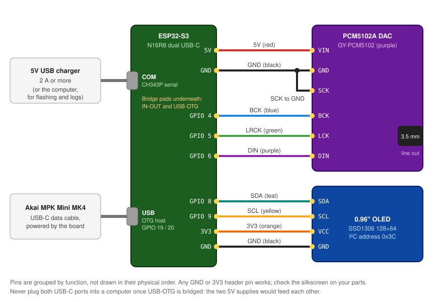

# Hardware build guide

How to build the mk4-synth hardware: the exact parts we used, how to prepare and wire them, how
to bring the build up one part at a time, and what to check when something doesn't work.

Only this one build has been tested. Other ESP32-S3 boards, DACs and displays should work with
pin changes; see "Building on other hardware" in [CONTRIBUTING.md](CONTRIBUTING.md), and please
report what you used.



## 1. Parts

| Qty | Part | What we bought | Notes |
| :--- | :--- | :--- | :--- |
| 1 | ESP32-S3 board, N16R8 (16 MB flash, 8 MB octal PSRAM), two USB-C ports | "ESP32-S3 Development Board Type-C WiFi+Bluetooth Internet of Things Dual Type-C Core Board ESP32-S3-DevKit N16R8" (sold in packs of 3 or 5; [Amazon](https://amzn.to/47Ypoyo)) | A clone of the VCC-GND Studio [YD-ESP32-S3](https://github.com/vcc-gnd/YD-ESP32-S3): a CH343P USB-serial chip on the **COM** port, native USB on the **USB** port. N16R8 matters: the wavetables live in PSRAM. |
| 1 | I2S DAC | GY-PCM5102 PCM5102A breakout (the purple board with a 3.5 mm jack; [Amazon](https://link.amazon/B07QhN2h2)) | Line-level stereo out. Any PCM5102A board that needs no I2C setup works. |
| 1 | OLED display | ELEGOO 0.96" I2C OLED, SSD1306, 128×64, yellow/blue ([Amazon](https://link.amazon/B0cLaqKIj)) | The firmware's layout assumes the yellow top band. Pin order differs between brands; go by the silkscreen. |
| 1 | MIDI controller | Akai MPK Mini MK4 (sold as "MPK mini IV"; [Amazon](https://link.amazon/B08fwMN1S)) | The only supported controller. The MK3 uses a different protocol. |
| 1 | USB-C to USB-C data cable | Short (≤ 0.5 m) | MK4 to the board's USB port. Charge-only cables don't carry data. |
| 1 | USB-C power | 5 V USB charger, 2 A or more, and a USB-C cable | Into the board's COM port. Powers the board, DAC, OLED and the MK4. |
| 1 | Perfboard | Rindion double-sided prototype PCB kit, 5 sizes, 2.54 mm pitch ([Amazon](https://link.amazon/B08Yu5FRJ)) | A board of about 7 × 9 cm fits everything. |
| | Pin headers | Ruibapa 2.54 mm male and female single-row header kit ([Amazon](https://link.amazon/B06NjIYUt)) | Female headers on the perfboard so the ESP32 and DAC can be unplugged; cut them to length. |
| | Wire and insulation | XINWANG 28 AWG silicone wire, 6 colours, tinned stranded copper ([Amazon](https://link.amazon/B03ewY7C5)); 1.5 mm and 2 mm heat shrink | Silicone wire survives soldering heat and bends without breaking. |
| | Audio | 3.5 mm TRS (stereo) cable, or headphones | See [troubleshooting](#7-troubleshooting) before using one TRS cable into an audio interface. |

**Tools** (the ones we use):

| Tool | What we use | Notes |
| :--- | :--- | :--- |
| Soldering station | Hakko FX888DX ([Amazon](https://link.amazon/B0F55YPC2T)) | Any temperature-controlled iron works; about 330 °C for this solder |
| Solder | Kester 44, 63/37 rosin core, 0.031" / 0.8 mm ([Amazon](https://link.amazon/B0hwdAo0T)) | Contains lead: work with ventilation and wash your hands afterwards |
| Desoldering braid | Chemtronics Chem-Wik, 0.050" ([Amazon](https://link.amazon/B0gyaL1mR)) | For fixing bridges and undoing joints |
| Helping hands | KOTTO 4-arm PCB holder ([Amazon](https://link.amazon/B06qMsS20)) | Holds the perfboard and wires while you solder |
| Multimeter | Fluke 117 ([Amazon](https://link.amazon/B0etiLtlS)) | For the continuity and voltage checks in step 5; any meter with a continuity beeper works |
| Also | Flush cutters, wire strippers, and a computer with [PlatformIO](https://platformio.org/) | |

The Amazon links above are affiliate links: buying through them supports the project at no
extra cost to you. As an Amazon Associate I earn from qualifying purchases. Any seller's equivalent part or tool works just as well.

## 2. Prepare the ESP32-S3 board

On the underside of the board, next to the USB-C ports, there are two solder pads. They ship
open, and this build needs **both bridged** with a blob of solder:

| Pad | What bridging it does | Why this build needs it |
| :--- | :--- | :--- |
| **IN-OUT** | Connects the COM port's 5 V to the **5V** header pin | The DAC's VIN is fed from the 5V pin. Open, the pin reads around 1.8 V. |
| **USB-OTG** | Sends 5 V out of the **USB** port | The MK4 is powered by the board. Open, the MK4 stays dark. |

> [!WARNING]
> With USB-OTG bridged, never plug **both** USB-C ports into a computer (or two power sources) at
> once: the two 5 V supplies feed each other. In this build the computer or charger only ever goes
> on COM, and the MK4 only ever goes on USB.

Solder female headers to the perfboard for the ESP32-S3 rather than soldering the board in, so
you can replace it later.

## 3. Prepare the DAC

The GY-PCM5102 needs no soldering on the back; its defaults are what this build uses. The one
thing to do is tie **SCK to GND** (a short wire, or the bridge pad next to the SCK pin if your
board has one). With SCK grounded, the DAC makes its own clock from BCK. Left floating, it can
lock up or crackle.

If your DAC board brings XSMT and FMT out as header pins, wire XSMT to 3V3 (unmute) and FMT to
GND (standard I2S).

## 4. Wire it

Keep the I2S wires (BCK, LRCK, DIN) short and away from the USB ports. Cover every exposed joint
with heat shrink.

**DAC ↔ ESP32-S3** (pins are set in `src/esp32s3_driver.h`)

| DAC pin | ESP32-S3 pin | Wire | Notes |
| :--- | :--- | :--- | :--- |
| VIN | 5V | red | **Use 5 V, not 3.3 V.** The board's own 3.3 V regulator needs the headroom; on 3.3 V the output picks up digital noise. |
| GND | GND | black | |
| SCK | GND | black | Or the SCK bridge pad (step 3) |
| BCK | GPIO 4 | blue | Bit clock |
| LCK (LRCK) | GPIO 5 | green | Left/right clock |
| DIN | GPIO 6 | purple | Audio data |

**OLED ↔ ESP32-S3** (pins are set in `src/oled_ui.h`)

| OLED pin | ESP32-S3 pin | Wire | Notes |
| :--- | :--- | :--- | :--- |
| VCC | 3V3 | orange | **3.3 V, not 5 V** |
| GND | GND | black | |
| SDA | GPIO 8 | teal | |
| SCL | GPIO 9 | yellow | |

**USB connections**

| Port | Connect to |
| :--- | :--- |
| **COM** (CH343P) | The charger for normal use, or the computer for flashing and serial logs |
| **USB** (native, GPIO 19/20) | The MK4, with a USB-C data cable |

The ports are labelled on the silkscreen. If yours aren't, the COM port is the one that shows up
on the computer as a `usbmodem` serial port while the board is running.

## 5. Check before power-up

With nothing plugged into USB, use the multimeter's continuity mode:

1. No continuity between 5V and GND, or between 3V3 and GND.
2. DAC VIN connects to the ESP32 **5V** pin, and OLED VCC to **3V3**, not the other way round.
3. SCK on the DAC reads as connected to GND.

Then plug the COM port into the computer, with the MK4 unplugged, and measure about 5 V between
5V and GND and 3.3 V between 3V3 and GND.

## 6. Bring-up, one part at a time

Flash a small test for each part before the full firmware, so a wiring fault shows up on its own.
The sketches are in [diagnostics/](diagnostics/README.md). Every build for this board must send
serial output to the COM port (USB CDC off); see the diagnostics README for the settings.

| Step | Test | Pass |
| :--- | :--- | :--- |
| 1 | `diagnostics/01_system_health` | The log shows 16 MB flash and 8 MB PSRAM, and the memory test passes |
| 2 | `make dac-test` (diagnostic 02) | A clean 440 Hz tone in both ears, then left only, then right only |
| 3 | `diagnostics/03_i2c_oled_test` | The I2C scan finds `0x3C` and a ball bounces on the OLED |
| 4 | `diagnostics/05_usb_mpk_test` | The MK4 lights up, the log shows it enumerating, and its screen changes |
| 5 | `diagnostics/06_ble_midi_nvs_test` | The board shows up over Bluetooth as `MK4-Synth` |
| 6 | `make flash` | The full firmware: the OLED shows the preset, and the MK4 plays sound |

Read the log during each step with:

```bash
python3 tools/synthctl.py capture 20      # needs pyserial: pip install -r tools/requirements.txt
```

Once everything passes, move the COM cable from the computer to the charger.

## 7. Troubleshooting

| Symptom | Likely cause | Fix |
| :--- | :--- | :--- |
| Board resets about once a second, often right after "BLE" in the log, with `rst:0x3 (RTC_SW_SYS_RST)` and no error; or `BROWNOUT_RST` | The 5 V supply sags when the radio starts while the MK4 is drawing power through the board | Use a 2 A charger and a short, thick cable on COM. Check that the board boots with the MK4 unplugged. A computer port or an unpowered hub is often not enough. |
| Only the ROM boot log appears, then nothing | The sketch was built with USB CDC on, so its log goes to the USB port | Rebuild with serial on UART0 (`-DARDUINO_USB_CDC_ON_BOOT=0`); the PlatformIO environments already do this |
| MK4 stays dark | USB-OTG pad not bridged, MK4 on the COM port, or a charge-only cable | Step 2; MK4 on the **USB** port; try another cable |
| MK4 lights up, but notes don't play | The log shows whether it enumerated | Run diagnostic 05 and check the log |
| No sound at all | SCK floating, or BCK/LRCK/DIN swapped | Step 3; run `make dac-test` and check the wiring table |
| Only one channel | A loose BCK/LRCK/DIN joint, or a mono cable | `make dac-test` plays left and right separately |
| Hiss or whine that follows the CPU or USB activity | DAC VIN on 3.3 V, or a ground loop through the computer | VIN on **5V**; run from the charger instead of the computer |
| Into an audio interface, some presets (Minimoog, Prophet-5, TB-303, PT-10) are almost silent while chorus presets sound fine | One TRS cable into one **balanced** interface input plays left minus right, which cancels any mono sound | Use a TRS to dual-TS (Y) cable into two inputs, or headphones. |
| OLED blank | VCC on the wrong rail, SDA/SCL swapped | Diagnostic 03 lists what the I2C scan finds |
| Crackles when holding big chords | The audio budget is exceeded (see [AGENTS.md](AGENTS.md)) | Report it with a profiling capture (`make profile`, then `make capture`) |

## 8. Construction tips

- Mount the DAC so the 3.5 mm jack is braced: plugging in a cable pushes hard on the board.
- Leave at least 1.5 mm around the USB-C openings in a case for thick cable plugs.
- If the OLED sits in a lid, use a 4-wire flexible lead about 60 mm long so the lid opens without
  pulling on the joints.
- Use 3-pole (TRS) plugs. A 4-pole (TRRS) headset plug can short the right channel.

## Revision history

| Rev | Summary |
| :--- | :--- |
| 1.0 | ESP32-WROOM-32E, DIN-5 MIDI in, PCM5102A |
| 2.0 | ESP32-S3 N16R8 with USB host for the MPK Mini MK4, SSD1306 OLED; DIN-5 removed. Volume is set from the MK4 (CC 7). |

How the MK4's screen and knobs are driven is in
[docs/MPK_MINI_IV_MIDI_REFERENCE.md](docs/MPK_MINI_IV_MIDI_REFERENCE.md) and the
[manual](docs/mpk_mini_mk4_manual.html); the firmware's structure is in [CONTEXT.md](CONTEXT.md).
